# DS Chat · DeepSeek API 客户端

一个用 **Kotlin + Jetpack Compose** 按 DeepSeek 官方安卓 App 的界面与交互做的**第三方客户端**。
和官方 App 唯一的差别：不登录 DeepSeek 账号，改为填写**你自己的 DeepSeek API Key**，
对话、深度思考、联网搜索、文件/图片输入、语音输入与朗读都直接走官方开放 API。

> 个人学习与自用项目，非官方应用；请勿上架或用于商业分发。

---

## 页面预览

| 首页 | 对话 |
|---|---|
| 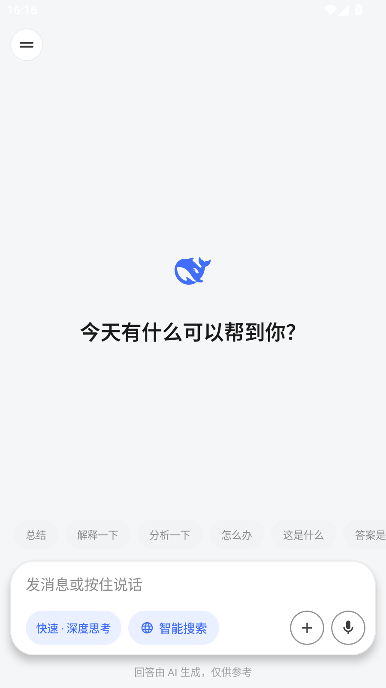 | 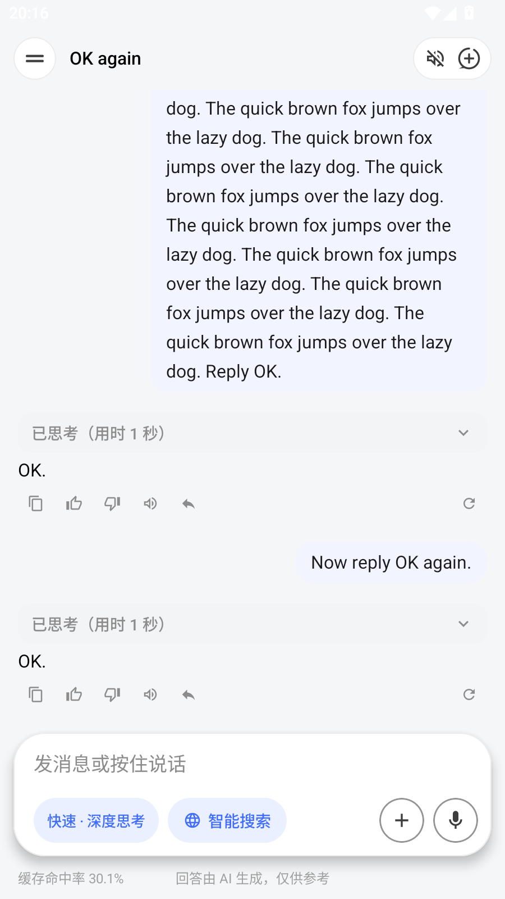 |

| 按段选文 + 手柄 | 长按菜单 |
|---|---|
| 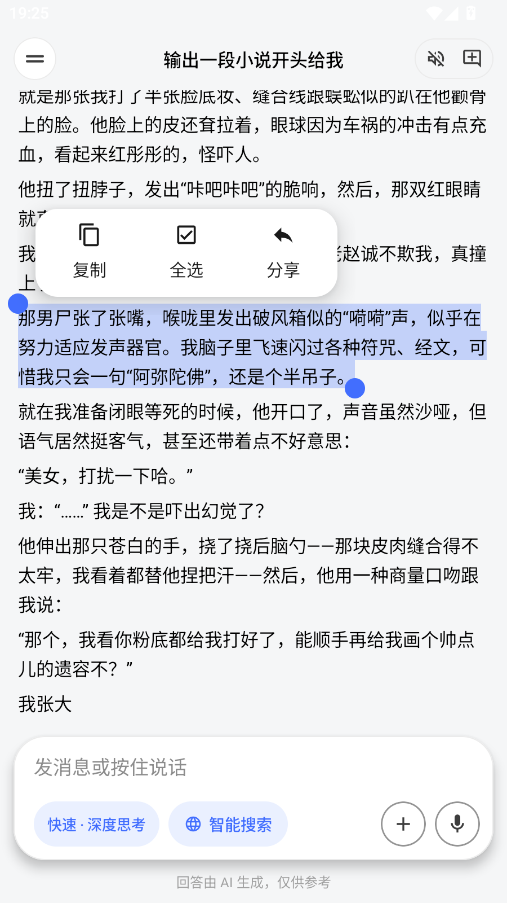 | 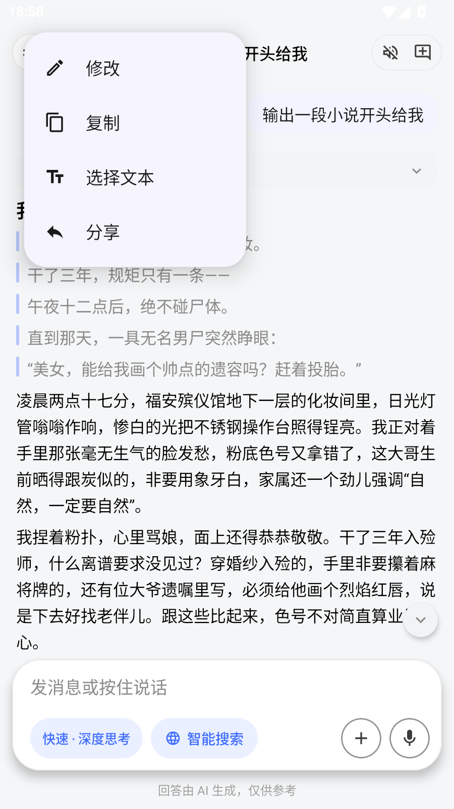 |

| 按住说话（局部渐变） | 设置 |
|---|---|
| 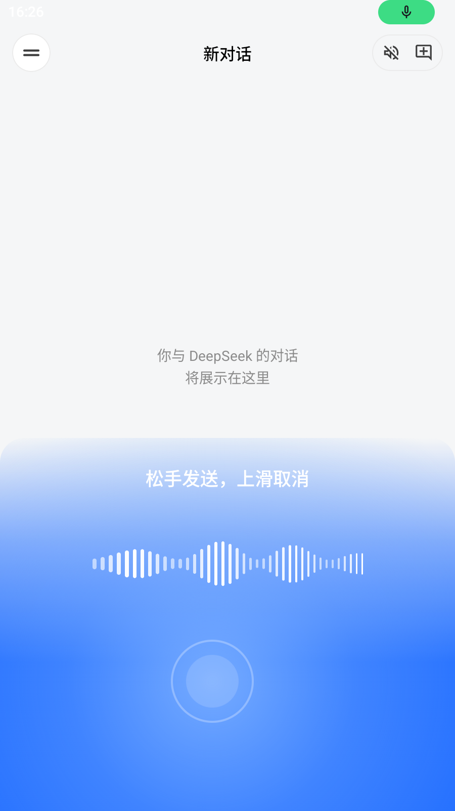 | 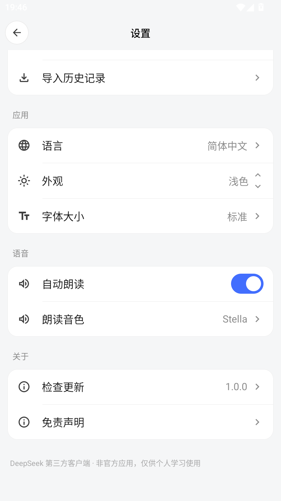 |

| 模型与思考等级 | 导入官方历史记录 |
|---|---|
| 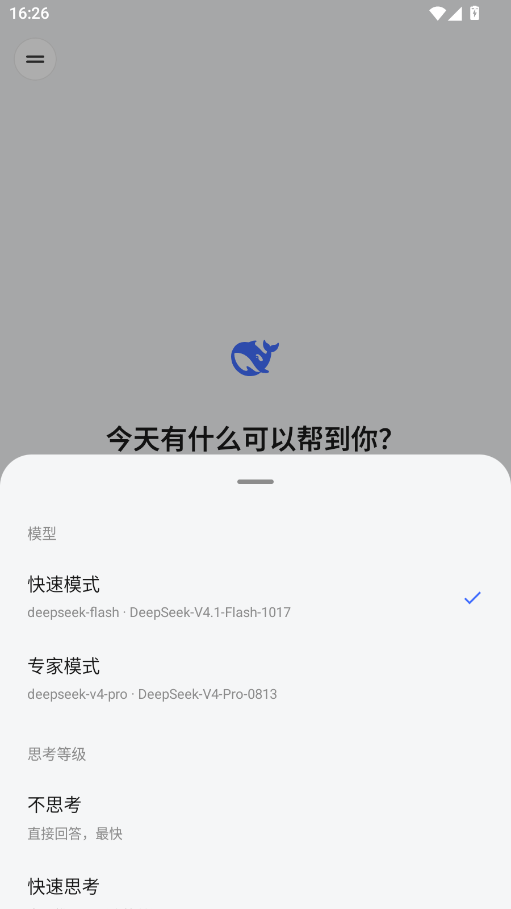 | 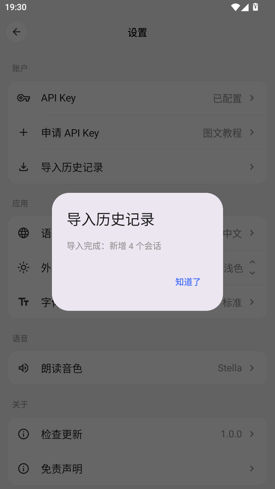 |

| 申请 API Key 教程 | 侧边栏历史 |
|---|---|
| 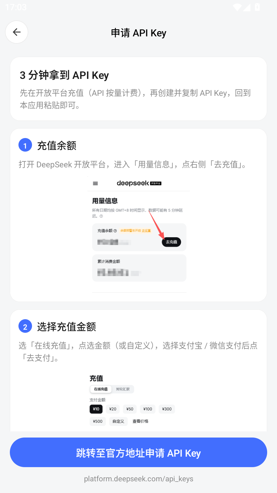 | 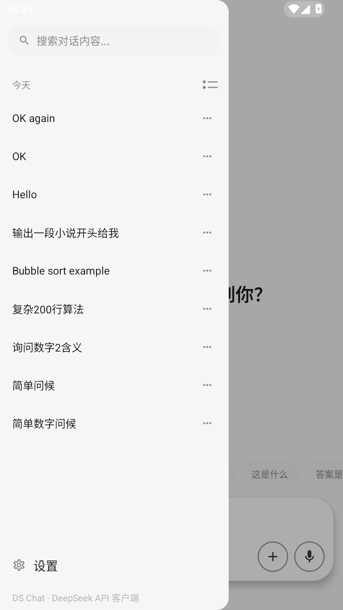 |

| 代码高亮 + LaTeX 公式 | 检查更新 |
|---|---|
| 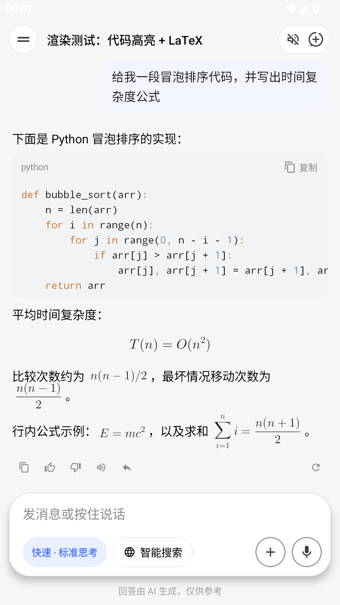 | 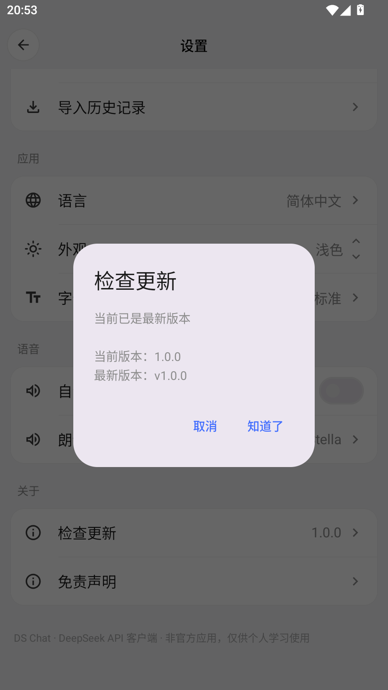 |

---

## 功能

**对话**
- 流式输出、Markdown（标题/列表/引用/分割线）
- 代码块：**语法高亮**（`dev.snipme:highlights`，支持 Kotlin/Java/Python/JS/TS/Go/Rust/C/C++/C#/Swift/PHP/Ruby/Dart/Shell 等），横向滚动 + 一键复制
- **LaTeX 公式**：行内 `$...$` 与块级 `$$...$$` 渲染（jlatexmath），失败自动回退源码
- 停止生成、重新生成、复制、点赞/点踩、分享、朗读
- 长按提问可「修改」后重新生成（截断该轮之后的消息）

**深度思考**
- 思考过程折叠展示、用时统计
- 思考等级：不思考 / 快速 / 标准 / 深度（对应 `output_config.effort`）
- 模型切换：快速模式（`deepseek-flash`）/ 专家模式（`deepseek-v4-pro`）

**联网与文件**
- 联网搜索：展示「正在搜索 / 已阅读 N 个网页」轨迹，回答下方列出可点击的引用来源
- 阅读链接：自动识别消息里的 URL 并抓取正文
- 文件与图片：PDF / Office / 图片上传（Files API），图片在气泡里直接预览

**语音**
- 按住说话：全屏之外只占下半屏的渐变面板，跟随手指，上滑取消
- 语音识别（ASR）自动发送、回复朗读（TTS）、顶栏喇叭一键开关**自动朗读**

**会话与设置**
- 侧边栏：今天 / 7 天内 / 30 天内分组、置顶、重命名、删除、多选批量删除、搜索
- 本地持久化（无需登录即可保留历史）
- 设置：API Key、模型与思考等级、外观（默认浅色，支持深色）、字体大小（带预览与刻度滑杆）、朗读音色、自动朗读、申请 API Key 图文教程、导入官方历史记录

**更新与维护**
- 设置 → 关于 → 检查更新：读取 GitHub Releases 的最新版本，提示「已是最新版本」或「发现新版本」并可跳转下载

**细节**
- 按段落选文：长按 → 选择文本 → 自动选中该段，两端出现可拖手柄，上方浮出「复制 / 全选 / 分享」
- 点空白自动取消选中并收起键盘
- 底部显示「缓存命中率 XX.X%」（取自 API 的 `cache_read_input_tokens`）
- 官方同款圆形新建对话图标、静音喇叭胶囊、输入框白卡片与浅蓝胶囊

## 与官方 App 的差异

| 项 | 官方 App | DS Chat |
|---|---|---|
| 登录方式 | DeepSeek 账号 | 自己的 API Key（仅存本机） |
| 账号体系 | 有（多端同步） | 无，纯本地 |
| 联网搜索 / 语音 | 服务端能力 | 走开放 API 的 `deepseek_web_search` / ASR / TTS |
| 费用 | 免费使用 | 按 API 用量计费（含搜索、语音工具费） |
| 设备风控 | 有 | 无（不涉及官方登录） |

## 技术栈

Kotlin 2.0.21 · Jetpack Compose（BOM 2024.10）· Material 3 · Navigation Compose ·
OkHttp + kotlinx.serialization（SSE 流式）· DataStore · AGP 8.7 / Gradle 8.9 · minSdk 26

第三方库：`dev.snipme:highlights`（Apache-2.0，代码语法高亮）、`jlatexmath-android`（GPLv2，LaTeX 渲染）

协议按官方 [chat-demo](https://github.com/deepseek-ai/chat-demo) 对齐：Anthropic 兼容 Messages API、
Files API、ASR / TTS 独立接口。

## 构建与安装

环境：JDK 17+、Android SDK（compileSdk 34）。

```bash
./gradlew :app:assembleDebug
adb install -r app/build/outputs/apk/debug/app-debug.apk
```

## 首次使用

1. 打开 App → 左上角菜单 → **设置** → **API Key**
2. 填入在 [platform.deepseek.com](https://platform.deepseek.com/api_keys) 创建的 Key（`sk-...`）
3. 点「测试连接」确认可用 → 保存 → 回首页开聊

> 还不知道怎么申请？设置里的「申请 API Key」有 7 步图文教程（充值 → 建 Key → 复制），
> 底部按钮可直接跳转官方页面。

**可选：导入官方 App 的历史记录**

设置 → 账户 → 导入历史记录 → 按提示在官方 App 里「设置 → 数据管理 → 导出所有历史对话」，
下载 `deepseek_data-日期.zip` 后选择该文件即可导入（同 id 会话自动跳过，图片原件一并导入）。

## 已知边界

- 无账号体系、无多端同步；数据只存在本机
- 联网搜索 / 语音 / 文件解析走开放 API，会按次/按时长计费，请注意余额
- 公式渲染依赖 jlatexmath（GPLv2），本仓库源码公开以符合其分发要求；复杂宏包（如 tikz、amsmath 的部分环境）不支持
- 语法高亮由 highlights 库提供语言集决定，SQL / JSON / YAML / HTML 等暂不高亮（库不支持，显示为等宽纯文本）
- 历史导入支持官方导出格式 `export_format_version = 3`；消息分支、编辑历史等不回放
- 缓存命中率在短对话下常为 0.0%（服务端缓存有最小前缀粒度）

## 免责声明

- 本项目为**个人学习用途**的界面复刻，界面文案与图标等版权归 DeepSeek 所有；
- 请勿上架应用商店、勿用于商业分发，勿使用 DeepSeek 名称/图标做对外宣传；
- 本项目不抓取官方 App 私有接口、不绕过其风控与登录限制；
- 通过本客户端产生的 API 与工具调用费用由使用者自行承担。
